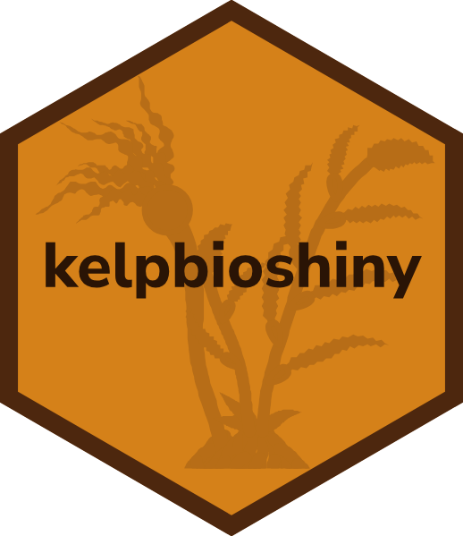

<!-- README.md is generated from README.Rmd. Please edit that file -->

```{r setup, include = FALSE}
knitr::opts_chunk$set(
  collapse = TRUE,
  comment = "#>"
)
```

# kelpbioshiny 

<!-- badges: start -->
[](https://github.com/HakaiInstitute/kelpbioshiny/actions/workflows/R-CMD-check.yaml)
[](https://lifecycle.r-lib.org/articles/stages.html#experimental)
<!-- badges: end -->

kelpbioshiny is a Shiny app for estimating kelp biomass. The models are
provided by the [kelpbio](https://github.com/HakaiInstitute/kelpbio) package;
see its documentation for details.

## Installation

Install from GitHub:

``` r
# install.packages("pak")
pak::pak("HakaiInstitute/kelpbioshiny")
```

## Usage

Run the app locally:

``` r
kelpbioshiny::run_app()
```

## Licensing

Copyright 2026 Tula Foundation.

The code is released under the [MIT License](LICENSE.md).
The pre-fit models and the Hakai Institute reference data the app offers come from [kelpbiodata](https://github.com/HakaiInstitute/kelpbiodata), under the CC BY 4.0 licence; any outputs that use them should carry its attribution statement (`kelpbiodata::kelpbiodata_attribution()`).
